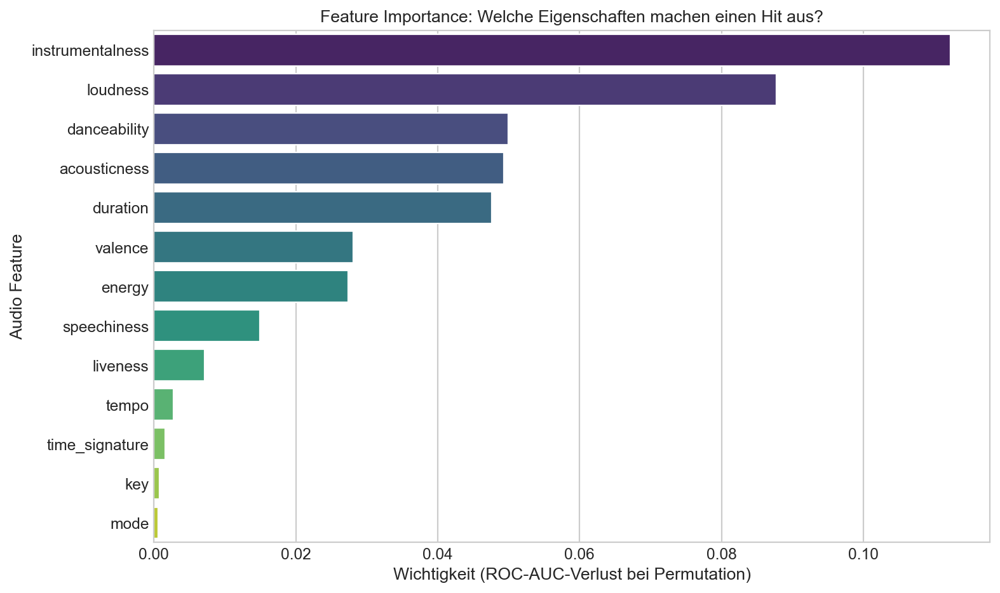
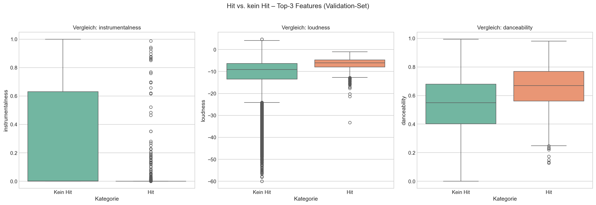

# Predicting Spotify Hits from Audio Features

An end-to-end data science project on **8.7 million Spotify tracks**: can a song's popularity be predicted from its audio features alone?

> **TL;DR** – Gradient boosting separates hits from non-hits well (**ROC-AUC 0.858** on a held-out test set of 1.3 M tracks), but hits are extremely rare (0.08 %), so audio features alone remain a weak signal. The strongest predictors are *instrumentalness*, *loudness* and *danceability*.

Final project for the course *Data Science with Python*.

## At a glance

| | |
|---|---|
| **Question** | Can audio features alone predict whether a track becomes a hit? |
| **Data** | ≈ 8.7 M tracks with 13 audio/track features · SQLite database, 9 tables, ≈ 5 GB |
| **Target** | `is_hit` = Spotify popularity ≥ 70 → 6,910 hits (0.08 % of all tracks) |
| **Models** | Logistic regression · random forest · HistGradientBoosting · feed-forward neural network (Keras) |
| **Best result** | Test ROC-AUC **0.8583** (HistGradientBoosting) |
| **Stack** | Python · SQL (SQLite) · pandas · scikit-learn · imbalanced-learn · TensorFlow/Keras · matplotlib · seaborn |

## Results

**Model selection on the validation set** (ROC-AUC):

| Model | ROC-AUC |
|---|---|
| Dummy baseline (most frequent class) | 0.5000 |
| Logistic regression | 0.8392 |
| Random forest | 0.8605 |
| **HistGradientBoosting (class weights)** | **0.8685** |

Imbalance strategies for HistGradientBoosting (validation ROC-AUC): class weights **0.8685** · random under-sampling 0.8653 · no correction 0.8357 · SMOTE 0.8127.

**Final evaluation on the untouched test set** (1,305,167 tracks, 1,036 hits):

| Model | ROC-AUC | Recall | Precision |
|---|---|---|---|
| HistGradientBoosting | 0.8583 | 75.2 % | 0.27 % |
| Feed-forward neural network | 0.8571 | 80.4 % | 0.23 % |

With only 0.08 % hits, precision stays very low: to catch about 75 % of the real hits, the model flags about 22 % of all tracks. The models are therefore useful for **ranking** tracks by hit likelihood, not as a standalone hit detector. The neural network does not beat gradient boosting, in line with the main finding that audio features carry only limited information about popularity.

## What makes a hit?

Permutation importance (drop in ROC-AUC when a feature is shuffled) and the distribution of the top three features for hits vs. non-hits:





- **Instrumentalness** is the strongest predictor – hits almost always contain vocals.
- **Loudness** and **danceability** follow – hits are louder and more danceable.
- Popularity is driven largely by factors outside the audio signal (artist fame, marketing, playlists). Natural next steps are combining audio features with artist metadata, genre information and temporal trends.

*Figure labels are in German, as in the notebook.*

## Approach

1. **Exploration and data-quality audit** (SQL + pandas): profiled missing values, orphan rows, duplicates and invalid value ranges – e.g. 95 % missing `is_playable`, 562 tracks without audio features, ≈ 35 k audio-feature rows with invalid tempo or time signature.
2. **Cleaning pipeline with a transparent log:** dropped unusable columns, removed incomplete and duplicate rows, enforced valid value ranges, capped duration outliers.
3. **Target definition:** hit = popularity ≥ 70, which results in a heavily imbalanced problem (0.08 % positives).
4. **Leakage-free setup:** stratified 70/15/15 train/validation/test split *before* scaling; models are selected on validation data only; the test set is evaluated once at the end.
5. **Modelling:** dummy baseline, logistic regression, random forest and HistGradientBoosting (class-weighted), plus a feed-forward neural network in Keras (3 hidden layers 256→128→64, batch norm, dropout, L2 regularisation, early stopping).
6. **Imbalance strategies compared:** class weights vs. random under-sampling vs. SMOTE.
7. **Interpretation:** permutation importance and a hit vs. non-hit comparison of the top features.

## Repository contents

```text
├── alexander_muhulica_dsp_project.ipynb   # full analysis, committed with all outputs
├── figures/                               # all 11 figures from the notebook, numbered in notebook order
├── requirements.txt                       # Python dependencies
└── README.md
```

## Data

The dataset (≈ 8.7 M tracks, SQLite, ≈ 5 GB) is too large for GitHub and therefore **not included**. To reproduce the analysis, place it in the repository root as `spotify.sqlite`; the notebook opens it with `sqlite3`. Tables: `tracks`, `audio_features`, `albums`, `artists`, `genres` and the relation tables `r_albums_artists`, `r_albums_tracks`, `r_artist_genre`, `r_track_artist`.

## Run it yourself

```bash
git clone https://github.com/AlexMuhulica/Data-Science-with-Python-Project.git
cd Data-Science-with-Python-Project
python -m venv .venv && source .venv/bin/activate
pip install -r requirements.txt
# put spotify.sqlite into the repository root, then:
jupyter lab alexander_muhulica_dsp_project.ipynb
```

Developed with Python 3.9. The notebook is committed **with all outputs**, so the results can be read directly on GitHub without running anything. A full run on the complete dataset takes a while (random forest ≈ 4.5 min, neural network ≈ 54 min on the author's machine).

## Notes

The notebook's narrative is written in German; code, metrics and figures are language-independent.

## Author

Alexander Muhulica · [GitHub](https://github.com/AlexMuhulica)
